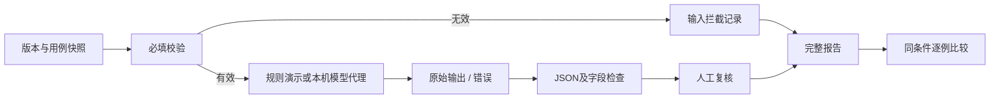

# 评测口径与技术取舍

## 为什么分三层

运行成功：调用完成且可解析；规则通过：满足预定义结构和事实字段；人工可用：人判断文案能否采用。这三者分别记录，避免一个绿色标记承担所有结论。

## 为什么不用另一个模型直接给总分

首版任务的事实字段可以直接比对。规则更便宜、可解释、可复现。自由文本部分留人工复核；未来如果使用LLM Judge，要与人工判断校准，不能把另一条生成结果当成事实证据。

## 演示数据与真实评测

内置12条用例由人工编写，属于合成验收集，不是训练数据。V1模拟错误、V2演示规则修正，这是产品流程样例。真实模型调用走同一检查器，但必须单独产生报告，不能沿用演示成绩。

## 运行快照与可比性

每次运行深拷贝提示词和完整用例，计算内容指纹。比较固定样本与规则；模式、模型也不同则拒绝直接比较。当前没有模型内部版本锁定、独立留出集及统计显著性，所以结论严格限定在当前用例。

## 数据流与代码地图

- `docs/core.mjs`：Case、Version、执行、检查、汇总与比较。
- `docs/app.js`：运行队列、停止、版本快照、本地存储和界面。
- `server.py`：环境配置、同源和输入限制、上游接口契约。
- `scripts/export-demo.mjs`：可重现的规则演示报告。

没有加入数据库、工作流平台和多Agent：单人本地作品的状态量较小，浏览器存储和JSON导出已能覆盖首条流程。后续多人协作才需要认证、数据库、任务队列和配额。
